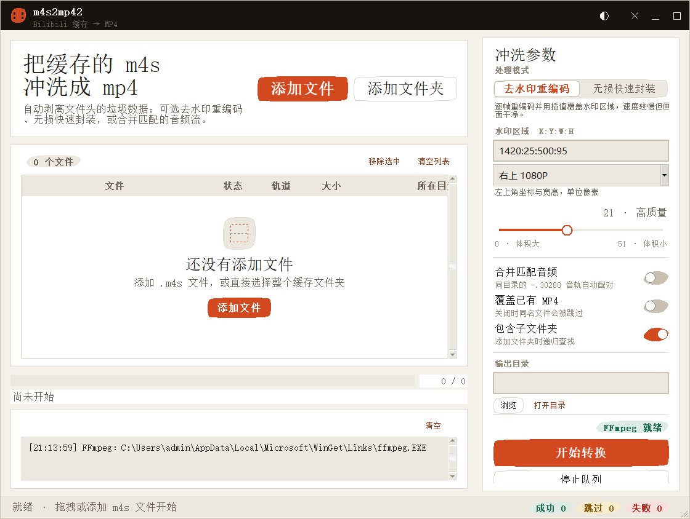
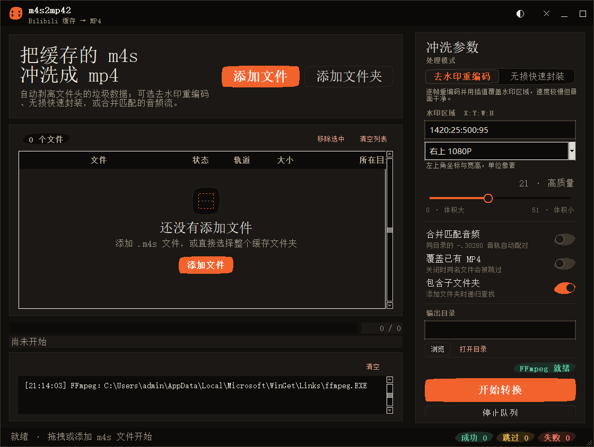

# m4s2mp42

一个用于将 Bilibili 缓存 `.m4s` 音视频流转换为 MP4 的桌面工具，提供亮色/暗色 GUI、批量队列、音频配对、可选去水印和命令行入口。


## 界面预览

| 亮色主题 | 暗色主题 |
| --- | --- |
|  |  |

## 功能

- 自动清理 Bilibili M4S 文件头前缀。
- 无损快速封装，或使用 `delogo` 去水印后重新编码。
- 自动配对同目录、同名称的视频流和音频流。
- 批量队列、递归扫描、粘贴路径、任务状态和运行日志。
- 已有 MP4 默认跳过，显式开启后才覆盖。
- 亮色/暗色主题及参数持久化。
- 输出先写临时文件，成功后再原子替换。
- GUI 与 CLI 共用同一套转换内核。

## 环境要求

- Python 3.10 或更高版本，需包含 Tkinter。
- FFmpeg。

程序按以下顺序查找 FFmpeg：

1. 程序目录中的 `ffmpeg.exe` 或 `ffmpeg`
2. 系统 `PATH`
3. Windows 下从 [Gyan.dev](https://www.gyan.dev/ffmpeg/builds/) 下载 essentials 构建

自动下载内容会经过 ZIP 结构检查和 `ffmpeg -version` 可执行验证。macOS 与 Linux 用户请使用系统包管理器安装 FFmpeg。

## 启动 GUI

Windows 可双击：

```text
启动 m4s2mp42.bat
```

也可以直接运行：

```bash
python m4s2mp42.py
```

## 命令行

```bash
# 单文件转换，默认去水印
python m4s2mp42_cli.py "视频-1-30080.m4s"

# 批量递归扫描并合并音频
python m4s2mp42_cli.py "D:\bilibili" --recursive --audio

# 无损快速封装
python m4s2mp42_cli.py "视频-1-30080.m4s" --no-delogo

# 指定输出目录、画质和覆盖策略
python m4s2mp42_cli.py "视频-1-30080.m4s" -o "D:\output" --crf 20 --overwrite
```

运行 `python m4s2mp42_cli.py --help` 可查看全部选项。

## 音视频配对

典型缓存文件如下：

```text
12345678-1-30080.m4s    视频流
12345678-1-30280.m4s    音频流
```

程序会移除末尾编码编号，以“所在目录 + 基础名称”进行配对。支持的视频编号为 `30080`、`30064`、`30032`，音频编号为 `30280`、`30216`、`30232`。

## 快捷键

| 按键 | 操作 |
| --- | --- |
| `Ctrl+O` | 添加文件 |
| `Ctrl+Shift+O` | 添加文件夹 |
| `Ctrl+V` | 粘贴路径 |
| `Ctrl+Enter` | 开始转换 |
| `Ctrl+D` | 切换主题 |
| `Ctrl+L` | 清空日志 |
| `Delete` | 移除选中项 |

## 配置文件

用户设置不会写入源码目录：

- Windows：`%APPDATA%\m4s2mp42\m4s2mp42_settings.json`
- macOS/Linux：`$XDG_CONFIG_HOME/m4s2mp42/`，未设置时使用 `~/.config/m4s2mp42/`

测试或便携环境可通过 `M4S2MP42_CONFIG_DIR` 指定配置目录。

## 开发与测试

```bash
python -m py_compile m4s2mp42.py m4s2mp42_cli.py m4s2mp4_core.py ffmpeg_bootstrap.py ui_tokens.py ui_widgets.py
python -m unittest -v test_core.py test_bootstrap.py
python test_smoke.py
```

GitHub Actions 会在 Windows 环境执行上述检查。

## 目录结构

```text
m4s2mp42/
├── .github/workflows/tests.yml
├── screenshots/
├── m4s2mp42.py
├── m4s2mp42_cli.py
├── m4s2mp4_core.py
├── ffmpeg_bootstrap.py
├── ui_tokens.py
├── ui_widgets.py
├── test_core.py
├── test_bootstrap.py
├── test_smoke.py
├── DESIGN.md
├── LICENSE
├── .gitignore
└── 启动 m4s2mp42.bat
```

## 许可证

本项目使用 [MIT License](LICENSE)。

请仅处理你有权使用的媒体文件，并遵守内容来源平台及著作权人的相关规定。
